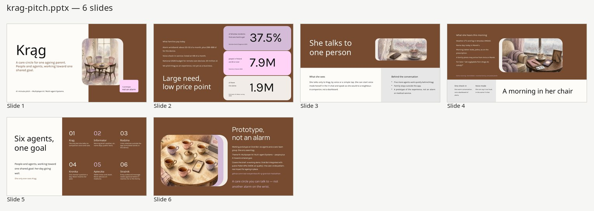

# Krąg

**Krąg** ("circle" in Polish) is a care team of Bots for one ageing parent. She talks only to Krąg, in chat or voice; the other five bots work in the team group. Family stays outside the app.

This is a prototype of the experience, not an alarm or a medical service. The demo family is invented. There is no real health data.

Krąg is a companion, not only a reminder. After a first meeting it learns how she likes to be addressed, who is close, and what she enjoys talking about, then carries those threads into later conversations — weather, a name day, a memory she left — the way a real person would.

## Hackathon Pitch

**Multiplayer AI / Multi-agent Systems track**

[Open the 1-minute pitch](pitch/krag-pitch.html) — a self-contained HTML presentation (six slides, keyboard/touch navigation, fullscreen support, optional 60s autoplay).

A PowerPoint version is also available: [krag-pitch.pptx](pitch/krag-pitch.pptx)

## First meeting

An unhurried voice visit in the Krąg 1:1 chat (taps are only a backup). See [`krag/first-meeting/session.md`](krag/first-meeting/session.md).

- A warm introduction, not a feature tour
- A short interview: how to address her, who is close, tablet times, what she likes to talk about, what to leave alone
- A plain-words offer of help: morning chat, weather, tablet reminder, a call to family, a photo, one memory question
- Notes stored in [`krag/first-meeting/portrait.json`](krag/first-meeting/portrait.json)

## For her

- A conversation partner for weather, light local news, name days, and whatever she wants to talk about
- A living portrait so later chats have story and context
- A morning check-in with real weather and air (no invented figures), today's name day, and a tablet prompt
- A morning picture that changes with the weather
- Simple taps or her own words: she's well, she took the tablet, or she wants a call
- A family photo after she answers (the photo behind the tap)
- One memory question a day, then a memoir built from her answers — no invented details
- Tablet reminders at her times, described only as on the mock prescription (for the demo: biała, jedna, at 09:00 and 19:00)
- A visit reminder when there is one (next: Thursday 12 November 2026 at 10:30, ortopeda, Marek driving)

## For the family

Family contact is simulated in this demo (placeholder emails and phones; nothing is emailed or texted).

- A request that a named relative call when she doesn't answer or asks for one (Ania first, then Marek; quiet hours 21:00–08:00 Europe/Warsaw)
- A way to send photos and short words back to her
- A refill note when stock is running low (20 tablets counted 5 November, last day 14 November)

## Safety and limits

- Strażnik approves every message before it goes out
- No medical advice, no dose calculation, no missed-dose guidance
- No streaks, scores, or pressure
- A fixed emergency text only; this is not an alarm or a medical service
- Drawn weather character, never a photo of an invented person
- Never invent weather, news, photos, or memoir details

## Care team

- **Krąg** — host; her one voice and conversation partner
- **Informator** — weather, air, forecast, visits, and checked public facts for conversation
- **Rodzina** — family link
- **Kronika** — memory and memoir
- **Apteczka** — tablets and stock
- **Strażnik** — approval

The first-meeting interviewer stays backstage: it prepares questions and writes the portrait, and never speaks to her. See [`krag/first-meeting/interviewer.md`](krag/first-meeting/interviewer.md) and [`krag/companion/style.md`](krag/companion/style.md).

## Repo

- `krag/` — shared workspace (see [`krag/README.md`](krag/README.md) for data sources and folder details)
- `krag/first-meeting/` — first session script, portrait, and backstage interviewer notes
- `krag/companion/` — how Krąg talks with her over time
- `krag/replay/demo-script-halina.md` — presenter script for a live demo
- `sessions/ideation-process-log.md` — planning session that led to the idea

Ready to show now: the first-meeting script, companion style, morning and evening lines. Not wired yet: the photo reveal, the memoir write-up, the live call-me handoff, the weather avatar, and the scheduled routines.
